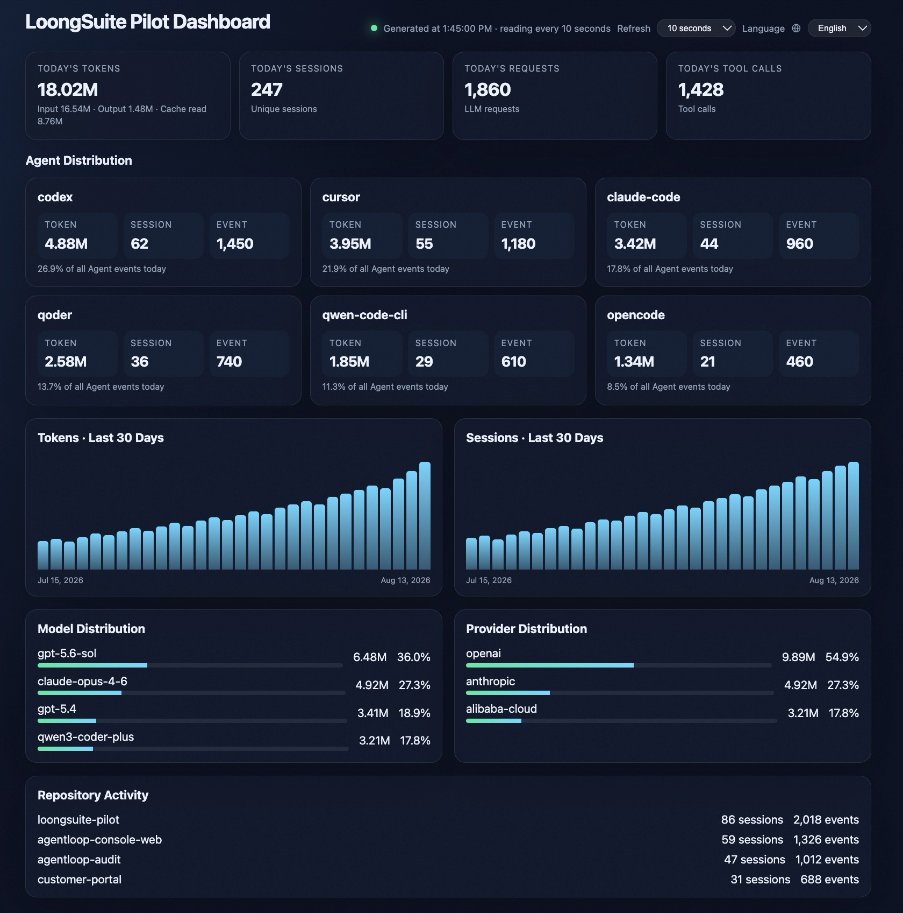
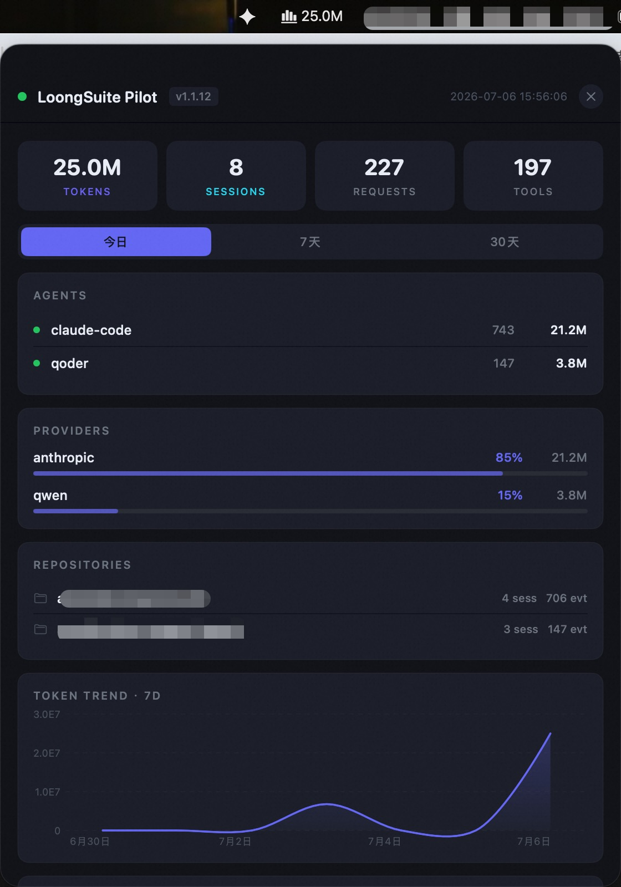

# LoongSuite Pilot


**Local telemetry collector for AI coding agents**

[](https://github.com/alibaba/loongsuite-pilot/actions/workflows/ci.yml)
[](https://github.com/alibaba/loongsuite-pilot/releases/latest)
[](LICENSE)
[](https://www.rust-lang.org/)
[](https://opentelemetry.io/)

**English** | [简体中文](README.zh-CN.md)

This branch develops the unreleased Rust-based Pilot 2.0.0 for `dev/v2.0.0`. The Node.js-based 1.x line remains on `main`; see [the migration discussion](https://github.com/alibaba/loongsuite-pilot/issues/511).

[Overview](#overview) | [Quick Start](#quick-start) | [Documentation](#documentation) | [Community](#community) | [Contributing](#contributing)

---

## Overview

LoongSuite Pilot is a local telemetry collector for AI coding agents. It discovers supported agents on a developer machine, installs the required hooks or plugins, normalizes activity into a shared GenAI event schema, and exports logs or traces to your chosen backends.

<p align="center">
  
  <br>
  <em>Built-in local dashboard — multi-agent token usage, sessions, requests, tools, models, providers, and repository activity at a glance.</em>
</p>

Development teams often use more than one AI coding agent, and each agent records activity in a different local format. Pilot gives teams one local collector that can discover those agents, collect their activity, normalize the data, and send it to destinations that are useful for analysis, audit, and observability.

Pilot is designed to answer practical questions:

- Which agents are being used?
- What model, session, turn, and tool activity happened?
- How much token usage is available from each agent?
- Where should the data be exported: local files, SLS, HTTP, or traces?
- How should sensitive prompts, tool arguments, and secrets be controlled before export?

## Highlights


| Capability               | What Pilot Does                                                                    |
| ------------------------ | ---------------------------------------------------------------------------------- |
| Agent discovery          | Detects supported agents from local paths and commands.                            |
| Collection deployment    | Installs hooks or plugins and reads local logs, sessions, or data files.           |
| Unified event schema     | Normalizes agent-native events into a shared GenAI schema.                         |
| Multi-destination output | Exports to JSONL, Alibaba Cloud SLS, HTTP, and OTLP trace backends.                |
| Privacy controls         | Supports per-agent content capture policy and secret masking before output.        |
| Local operations         | Provides service status, restart, rollback, and a built-in local dashboard. |


## Supported Agents


| Agent         | Integration               | Trace Export | Log Export | Token Usage | Conversation / Tool Calls |
| ------------- | ------------------------- | ------------ | ---------- | ----------- | ------------------------- |
| Claude Code   | Hook                      | Yes          | Yes        | Yes         | Yes                       |
| Codex         | Hook                      | Yes          | Yes        | Yes         | Yes                       |
| GitHub Copilot CLI | Native plugin + transcript / native OTel | Yes | Yes | Yes (native OTel) | Yes |
| Cursor        | Hook                      | Yes          | Yes        | Yes         | Yes                       |
| Cursor CLI    | Shared Cursor hook        | Yes          | Yes        | Yes         | Yes                       |
| DeepSeek Harness | YAML patch plugin + local JSONL polling | Yes | Yes | Yes | Yes |
| Grok Build    | Hook + local session logs | Yes          | Yes        | Yes         | Yes                       |
| Hermes Agent  | Native directory plugin   | Yes          | Yes        | Yes         | Yes                       |
| Kiro CLI      | Hook / session polling    | Yes          | Yes        | No          | Yes                       |
| MiMo Code     | Plugin injection          | Yes          | Yes        | Yes         | Yes                       |
| OpenClaw      | Plugin injection          | Yes          | Yes        | Yes         | Yes                       |
| OpenCode      | Plugin injection          | Yes          | Yes        | Yes         | Yes                       |
| Pi Coding Agent | Extension injection     | Yes          | Yes        | Yes         | Yes                       |
| Qoder         | Hook                      | Yes          | Yes        | Yes         | Yes                       |
| Qoder CN      | Hook                      | Yes          | Yes        | Yes         | Yes                       |
| Qoder for JetBrains | Detection-only      | Yes          | Yes        | Yes         | Yes                       |
| Qoder CLI     | Hook / session polling    | Yes          | Yes        | Yes         | Yes                       |
| Qoder Work    | Hook / local data polling | Yes          | Yes        | Yes         | Yes                       |
| Qoder Work CN | Hook / local data polling | Yes          | Yes        | Yes         | Yes                       |
| Qwen Code CLI | Hook                      | Yes          | Yes        | Yes         | Yes                       |
| Qwen Work CN  | Hook / local data polling | Yes          | Yes        | Yes         | Yes                       |
| Wukong        | CLI API polling           | Yes          | Yes        | Yes         | Yes                       |
| WorkBuddy     | Hook wakeup + local transcript watch/poll fallback | Yes          | Yes        | Yes         | Yes                       |
| [Doubao Work (macOS/Windows, experimental)](docs/doubao-work.md) | Read-only logs + execution metadata | Client turns, local tools + native sandbox executions | Metadata only | No | No |

GitHub Copilot CLI automatic deployment supports Unix shells. Exact per-call token usage requires native OTel; transcript-only collection omits unavailable usage. Windows and subagents are not supported. See [telemetry details](docs/zh-CN/copilot-native-telemetry.md).

OpenClaw integration supports 2026.3.8 or later with automatic version detection. Before 2026.5.12, model-call timing is inferred from legacy hooks; see [compatibility details](docs/agents.md#openclaw-compatibility-and-lifecycle).

DeepSeek Harness (`dsh`) loads Pilot's observability plugin from its user-level
`cordis.patch.yml`. The integration captures native LLM, reasoning, tool, token,
and time-to-first-token events. See [Agent Configuration](docs/agents.md#deepseek-harness-collection-and-lifecycle)
for activation, source-log, disable, and uninstall behavior.

### Documented Windows Agent Support

The table above describes Pilot's general integration capabilities; it does not imply that every agent is supported on every operating system. The following agents are currently explicitly documented as supported on Windows:

| Agent | Windows Integration | Trace Export | Log Export | Token Usage | Conversation / Tool Calls | Requirement |
|-------|---------------------|--------------|------------|-------------|---------------------------|-------------|
| Claude Code | Hook | Yes | Yes | Yes | Yes | — |
| Cursor | Hook | Yes | Yes | Yes | Yes | — |
| Qoder Work | Hook / local data source | Yes | Yes | No | Yes | User edition |
| Qoder CLI | Hook | Yes | Yes | No | Yes | — |
| Qoder IDE | Hook / local data source | Yes | Yes | Yes | Yes | Qoder 1.10.0 or later, User edition |
| OpenCode | Plugin injection | Yes | Yes | Yes | Yes | — |
| WorkBuddy | Hook wakeup + local transcript | Yes | Yes | Yes | Yes | WorkBuddy Desktop 5.3.5.0; Windows 11 installed-product E2E |

Agents omitted from this Windows table do not currently have an explicit Windows support statement; omission does not necessarily mean that the agent cannot run on Windows. See the [Alibaba Cloud AI Coding Agent access guide](https://help.aliyun.com/zh/cms/cloudmonitor-2-0/ai-application-access-ai-coding-agent/) for the source support matrix and [Installation](docs/installation.md) for Windows prerequisites and setup.


Agent definitions live in `agents.d/`. You can add new agents without changing the deployment framework; see [Agent Onboarding](docs/agent-onboarding.md).

## Quick Start

Prerequisites:

- Pilot packages ship a native Rust binary. The collector, updater, CLI, and standalone hook processors need no Node.js, npm, Python, or Rust toolchain.
- Linux/macOS: a system shell, `curl` or `wget`, and `tar`. Windows: PowerShell 5.1 or later.
- In-process JS/Python plugins use the Agent's own runtime, not a Pilot-managed runtime.

This branch contains the Rust migration. Target support is not evidence of platform acceptance. The legacy OSS endpoint is not guaranteed to serve Rust packages. Prefer the matching installer, platform archive, and checksums from one Release and pass an explicit package URL; see [Rust packages](docs/installation.md#rust-packages-and-platforms). The OSS commands below describe the historical distribution channel.

Install from the public package on Linux or macOS:

```bash
curl -fsSL https://loongcollector-community-edition.oss-cn-shanghai.aliyuncs.com/loongsuite-pilot/installer.sh -o /tmp/loongsuite-pilot-installer.sh && bash /tmp/loongsuite-pilot-installer.sh install
```

Install from the public package on Windows:

```powershell
$installer = "$env:TEMP\loongsuite-pilot-installer.ps1"
Invoke-WebRequest `
  -Uri "https://loongcollector-community-edition.oss-cn-shanghai.aliyuncs.com/loongsuite-pilot/installer.ps1" `
  -OutFile $installer
powershell.exe -NoProfile -ExecutionPolicy Bypass -File $installer install
```

Verify the service:

```bash
loongsuite-pilot status
loongsuite-pilot info
```

Local JSONL output is enabled by default under `~/.loongsuite-pilot/logs/output/` on Linux/macOS and `%USERPROFILE%\.loongsuite-pilot\logs\output\` on Windows.

For installer options, uninstall commands, and source builds, see [Installation](docs/installation.md).

## Configure Pilot

Configuration is loaded in this order: environment variables, then `~/.loongsuite-pilot/config.json`, then built-in defaults.

Start with the guide that matches what you want to change:


| Task                                             | Guide                                            |
| ------------------------------------------------ | ------------------------------------------------ |
| Choose agents and content capture policy         | [Agent Configuration](docs/agents.md)            |
| Write local JSONL logs                           | [Local JSONL Output](docs/local-jsonl-output.md) |
| Report logs to SLS                               | [SLS Output](docs/sls-output.md)                 |
| Report OTLP traces                               | [Trace Output](docs/trace-output.md)             |
| POST events to HTTP                              | [HTTP Output](docs/http-output.md)               |
| Mask secrets before output                       | [Data Masking](docs/masking.md)                  |
| See global config loading and retention settings | [Configuration Guide](docs/configuration.md)     |


### Upstream Trace Linking (optional)

Link collected agent spans to an **upstream** trace so each turn's span tree reparents under the upstream span. Disabled by default, and fully fail-open (never affects normal collection/reporting).

| Setting | Values | Default |
| ------- | ------ | ------- |
| `LOONGSUITE_PILOT_UPSTREAM_LINK` (env) · `upstreamLink.enabled` (config.json) | `true` / `1` to enable; unset, `false`, or `0` to disable | disabled |
| `LOONGSUITE_PILOT_UPSTREAM_LINK_PROPAGATE_TO_TOOLS` (env) · `upstreamLink.propagateToTools` (config.json) | propagate trace context and optional resource attributes to supported CLI tool calls | disabled |
| `LOONGSUITE_PILOT_UPSTREAM_LINK_PROPAGATE_TO_LLM` (env) · `upstreamLink.propagateToLlm` (config.json) | forward trace context to the LLM gateway as a `traceparent` request header (Claude Code) | disabled |
| `LOONGSUITE_PILOT_UPSTREAM_LINK_GENERATE_TRACE_WHEN_MISSING` (env) · `upstreamLink.generateTraceWhenMissing` (config.json) | generate and propagate a per-turn local trace context when no valid upstream context is available | disabled |
| `LOONGSUITE_PILOT_UPSTREAM_LINK_TTL_MS` (env) · `upstreamLink.ttlMs` (config.json) | cleanup TTL in ms for `acp-correlate` files | `86400000` (24h) |

When enabled, the upstream `traceparent` reaches Pilot via one of two schemes and is stamped onto collected records (`trace_id` on the turn, `parent_span_id` on the user-input event):

- **Correlation file** (per-turn): the caller writes `{sessionId, contentHash, contentPrefix, traceparent}` to `~/.loongsuite-pilot/acp-correlate/<sessionId>.jsonl` when it sends a prompt. Linking is protocol-agnostic, but requires a supported collector/plugin that emits the turn's user-input event. `sessionId` must match the native `gen_ai.session.id` Pilot collects, and the content hash or prefix must match that input. OpenClaw and Hermes require the collector fixes in [PR #508](https://github.com/alibaba/loongsuite-pilot/pull/508); Hermes also requires updating its deployed Pilot plugin and restarting Hermes. See the [per-turn setup and deployment requirements](docs/zh-CN/upstream-trace-correlation.md). ACP clients satisfy this naturally (the `session/new` id flows into collection), so ACP is the primary case.
- **Environment** (`TRACEPARENT` on the agent process): applied to the session's first turn only when a supported Pilot hook calls `recordUpstreamContextOnce` to write a session record. The OpenClaw and Hermes plugins do not read `TRACEPARENT` directly. Use this scheme with a supported hook when the caller cannot obtain a per-turn `sessionId` up front.

For Claude Code, enabling both `upstreamLink.enabled` and `propagateToTools` passes context into main-agent `Bash` calls. Pilot's `PreToolUse(Bash)` hook reserves the TOOL span id, prepends `TRACEPARENT` (and valid `TRACESTATE`, when present) to the Bash command, then reuses that id when the Stop hook builds the TOOL span. Optionally enable `generateTraceWhenMissing` so turns without upstream context generate and propagate a local trace. Set `LOONGSUITE_PILOT_RESOURCE_ATTRIBUTES` on the Claude Code process to have Pilot map it to standard `OTEL_RESOURCE_ATTRIBUTES` for the downstream CLI. Prefer `config.json` for the `upstreamLink` switches: environment variables affect only processes that inherit them, and `loongsuite-pilot restart` alone does not change an already-running Claude Code hook environment. The downstream CLI must extract Trace Context and configure its own exporter. This capability is fail-open and currently does not cover ACP-only downstream trace propagation, subagents, PowerShell, MCP tools, or non-Bash tools.

Enabling both `upstreamLink.enabled` and `propagateToLlm` extends the same trace to the **LLM gateway**: Claude Code's fetch preload injects a `traceparent` header on outgoing `/v1/messages` requests, passing trace-id and flags through untouched and replacing parent-id with the span id of that physical request, so gateway-side spans nest under it. A retried call emits one LLM span per attempt, and each attempt advertises its own span id, so the gateway's spans nest under the attempt that actually issued them. A `traceparent` the caller already set is never overwritten, and the whole path is fail-open.


## Output Data


| Backend    | Use Case                                                                |
| ---------- | ----------------------------------------------------------------------- |
| JSONL      | Local backup and easy inspection. Enabled by default.                   |
| SLS        | Alibaba Cloud Log Service reporting. Supports WebTracking, AK, and API Key modes. |
| HTTP       | POST batches to a custom endpoint.                                      |
| OTLP Trace | Export GenAI activity as OpenTelemetry traces.                          |


LoongSuite Pilot emits a normalized GenAI event schema across all supported agents. See [Output Event Schema](docs/output-event-schema.md) for event names, field definitions, provider values, finish reasons, and sensitivity notes for opt-in content fields.

## Operate Pilot

Use the `loongsuite-pilot` command after installation:

```bash
loongsuite-pilot start
loongsuite-pilot stop
loongsuite-pilot restart
loongsuite-pilot status
loongsuite-pilot info
loongsuite-pilot token-usage
loongsuite-pilot rollback
```

The local dashboard starts and stops with the collector. Open
`http://127.0.0.1:8765/`; no separate monitor command is required. It reads the
collector-owned `logs/metrics-summary.json` file directly.

On macOS, optionally run `loongsuite-pilot dashboard shortcut install` to create a
Dashboard `.webloc` shortcut with a radar icon and add it to the Dock's files area.
Normal installation and upgrades do not add shortcuts. It opens the configured
URL in your default browser without starting or stopping Pilot. After changing
the port, run the shortcut install command again. See [Dashboard shortcut](docs/installation.md#macos-dashboard-shortcut).

macOS menu bar app:

To disable automatic menu bar startup during installation, append `--enable-status-bar-app false` to the install command. This persists `enableStatusBarApp` in `config.json` before the collector starts. Omit the option to preserve the existing setting, or pass `true` to enable it. See the [installation guide](docs/installation.md#start-or-stop-the-macos-menu-bar-app).

On macOS, Pilot runs a menu bar app after installation by default. It shows live token, session, request, and tool counts, plus per-agent and per-provider breakdowns, so you can keep an eye on activity without opening the dashboard.

If you quit the menu bar app, reopen it without restarting collection:

```bash
loongsuite-pilot menubar start
```

Run this in your macOS desktop terminal without `sudo`. Pilot must already be running. The command persists `"enableStatusBarApp": true` in the active `config.json`; repeated calls reuse the running app.

To close only the menu bar app, run `loongsuite-pilot menubar stop`. Collection keeps running, and stopping an already closed app succeeds. The command persists `"enableStatusBarApp": false`, so the next collector startup leaves it closed.

<p align="center">
  
</p>

The `LOONGSUITE_PILOT_ENABLE_STATUS_BAR_APP` environment variable still has higher priority than `config.json`. Unset a disabling value before `menubar start`; an enabling value can override the setting written by `menubar stop` on future Pilot starts.

## Documentation

[User Manual](docs/README.md) - Complete guide to installing, configuring, operating, and extending Pilot

[Installation Guide](docs/installation.md) - Install from package, verify service, uninstall, and run from source

[Configuration Reference](docs/configuration.md) - Global config loading, runtime switches, retention, and links to output and privacy setup

[Output Schema](docs/output-event-schema.md) - Normalized event names, fields, provider values, and finish reasons

[Developer Guide](docs/agent-onboarding.md) - Add support for a new AI coding agent

## Development

```bash
git clone https://github.com/alibaba/loongsuite-pilot.git
cd loongsuite-pilot
python3 scripts/build/prepare-rust-dependencies.py
cargo build --locked --release
./target/release/loongsuite-pilot --help
```

The root npm manifest is private and contains optional host-plugin development tools.\nIts default build, start, typecheck and test commands delegate to Cargo. Installing\nthose tools does not deploy Hooks; use the native CLI for installation. Host-only\nchecks have explicit `test:host:*` scripts.\n\nFor local development:

```bash
cargo fmt --all -- --check
cargo clippy --workspace --all-targets --all-features --locked -- -D warnings
cargo test --workspace --locked --all-features
```

GNU release artifacts retain a glibc 2.34 baseline. On an older Linux development
host, build the verification image and run the same locked workspace tests with
Rust 1.99.1 inside it:

```bash
docker build -f scripts/testing/containers/glibc234.Dockerfile -t pilot-dev-glibc234:20261030 scripts/testing/containers
PILOT_TEST_RUST_ROOT=/opt/rust scripts/testing/verify-glibc234.sh
```

The verifier mounts only the checkout and the explicitly selected toolchain,
uses a temporary container HOME, and keeps its build output in
`target/glibc234`. It checks the actual glibc version and does not lower
dependency versions. Installed GNU candidates can also be checked with
`scripts/testing/container_preflight.py` using a synthetic read-only HOME.
Container verification does not switch an existing collector installation.

The toolchain is pinned to 1.99.1 in `rust-toolchain.toml`. Running the binary without a subcommand starts collection and may deploy Agent configuration; `--help` is read-only.

For local packaging, see [Installation](docs/installation.md). Release gates, CI budgets, and deferred test priorities are documented in [Rust release and testing](docs/zh-CN/rust-release.md).

## Contributing

Issues and pull requests are welcome. Before submitting a change, run the same core checks used by CI:

```bash
cargo fmt --all -- --check
cargo clippy --workspace --all-targets --all-features --locked -- -D warnings
cargo test --workspace --locked --all-features
```

To add support for another AI coding agent, start with the [Agent Onboarding Guide](docs/agent-onboarding.md). Report bugs and propose features through [GitHub Issues](https://github.com/alibaba/loongsuite-pilot/issues).

## Community

We are looking forward to your feedback and suggestions. Scan the QR code below to join the LoongSuite Pilot DingTalk group.

| LoongSuite Pilot SIG |
|----|
|  |

## LoongSuite Ecosystem

| Project | Role |
| ------- | ---- |
| [LoongCollector](https://github.com/alibaba/loongcollector) | High-performance collector for logs, metrics, traces, events, and profiles. |
| [LoongSuite Java](https://github.com/alibaba/loongsuite-java) | Shared GenAI telemetry utilities for Java instrumentation. |
| [LoongSuite Go](https://github.com/alibaba/loongsuite-go) | Compile-time auto-instrumentation for Go applications. |
| [LoongSuite Python](https://github.com/alibaba/loongsuite-python) | OpenTelemetry auto-instrumentation for Python and GenAI applications. |
| [LoongSuite JS](https://github.com/alibaba/loongsuite-js) | OpenTelemetry integrations for JavaScript AI agents. |
| [LoongSuite Pilot](https://github.com/alibaba/loongsuite-pilot) | Local telemetry collector for AI coding agents. |

## License

Apache License 2.0 - see [LICENSE](LICENSE) for details.
