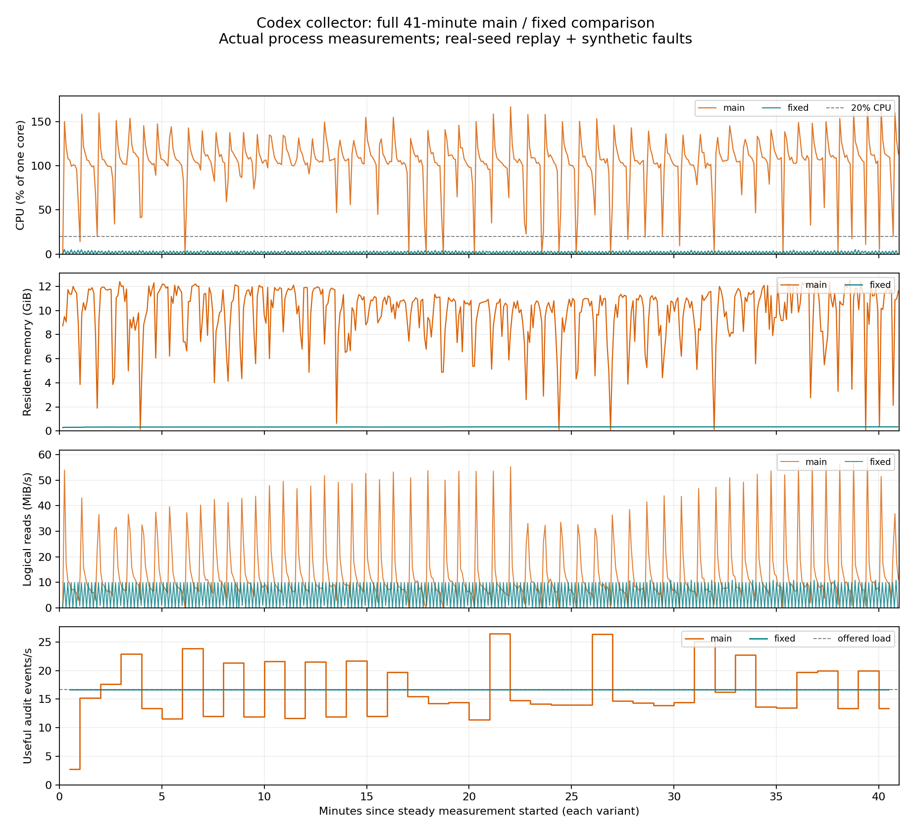

# Codex 读放大修复：连续窗口长测与真实云端补测

测试日期：2026-10-30。基线 `main f84e3881958b39c5c7cbe8a035f50ccd80a25783`，修复代码 `bb326bf1bf0cf64bb0a64fed7ebddd38fb0815f2`。本报告仅发布匿名汇总，源会话、原始遥测和接入配置保留本地。

## 方法和可解释范围

- 同一台 macOS arm64、48 GiB 内存、15 个逻辑 CPU 的工作站，Node 22.22.2、默认 JS 堆；分别运行冻结构建，按 main → 修复版顺序各测一次。
- 每版预热 60 秒、稳态观测至少 2,460 秒（41 分钟），之后排空再正常停止。输入轮询保持默认 10 秒；进程采样每 5 秒。原生 L1/L2 指标保持 600,000 毫秒窗口，没有缩短计时器；排除混入启动阶段的窗口。
- 使用完整 collector、隔离 HOME/数据目录及端口。本轮长测将 SLS/OTLP 输出送至本地 loopback 接收端，拦截外部网络。它测量本机采集和本地输出能力，不测量真实云网络的持续吞吐。
- 正常输入来自一次实际 `qwen3.8-max` 编码会话：3 轮、38 次工具调用、167 条标准事件。每 10 秒发布一个独立会话副本，稳态共 246 个，另有 1 个预热副本。两版读取逐字节相同的文件，独立事件身份在两版间保持一致，以便逐事件核验。长测阶段没有重新执行这些模型调用。
- 同时保留两个独立的合成故障输入：544 MiB 内容的完整 FileChange 记录，以及 32 MiB 静止未换行尾部。它们不是模型自然生成或客户原始日志。
- CPU 由目标 collector 的进程 CPU 时间差计算，100% 约为一个核；RSS 是采样峰值。逻辑读取量按实际 FileHandle.read 返回字节累计，不等于物理磁盘 I/O。不同故障输入分别归因。
- 正常事件吞吐只计算成功写入本地 JSONL 的业务事件；延迟从整个会话文件原子发布到对应事件成功落盘，不是模型响应延迟或云端 ACK。使用观测时间以外的完整事件内容进行哈希等价校验。
- 这是单机顺序单次对照。修复版测量后半段另有独立的真实 Qwen/云端验证进程运行；CPU 统计不包含其他进程，但主机共享资源干扰仍然存在。结果不外推为线上人群降幅或重复试验置信区间。

## 长测结果

两版都正常退出、未触发资源保护，输出探针与落盘文件完全对齐，无探针错误或外部网络泄漏。冻结构建及 15,722 个依赖文件的前后 SHA-256 校验均未变化。

| 指标 | main | 修复版 |
| --- | ---: | ---: |
| 稳态测量时长 | 2,460.401 s | 2,460.353 s |
| 连续完整原生十分钟窗口 | 3 | 3 |
| 平均 CPU | 104.084% | 1.781% |
| CPU p95 / 峰值 | 146.087% / 170.708% | 3.815% / 5.164% |
| RSS 采样峰值 | 12,793.109 MiB | 353.406 MiB |
| 稳态逻辑读取 | 36,082,325,022 B | 12,893,854,927 B |
| 字符串长度异常（含启动及排空） | 58 | 0 |
| 正常事件最终输出 / 预期（含预热） | 41,249 / 41,249 | 41,249 / 41,249 |
| 正常工具调用 / 结果（含预热） | 9,386 / 9,386 | 9,386 / 9,386 |
| 重复事件 ID | 0 | 0 |
| 稳态发布事件在稳态内落盘 | 40,383 | 41,082 |
| 稳态实际正常事件输出速率 | 16.413 条/s | 16.698 条/s |
| 正常事件落盘延迟 p50 | 55.049 s | 5.897 s |
| 正常事件落盘延迟 p95 / p99 | 88.657 s / 95.922 s | 9.683 s / 9.813 s |
| 正常事件最大落盘延迟 | 113.072 s | 9.852 s |
| 工具事件落盘延迟 p95 | 88.656 s | 9.683 s |

正常事件身份集合完全一致；41,249 条事件逐一排除 `observed_time_unix_nano` 后，完整内容哈希差异为 0。稳态发布的 41,082 条事件全部覆盖延迟观测，负延迟为 0。main 有 699 条稳态发布事件延至排空阶段落盘；修复版全部在稳态内落盘。预热 167 条不纳入稳态吞吐和延迟统计。

在这个故障混合负载中，平均 CPU 降低约 98.29%、RSS 采样峰值降低约 97.24%，延迟 p95 降低约 89.08%。这是本次工作站上指定场景的观察值；正常输入短测没有观察到平均 CPU 改善。稳态输出速率约提升 1.73%，反映固定供给下积压减少，**不是最大吞吐能力提升 1.73% 的证明**。两版最终都完整输出正常事件，不能将 main 的延迟误写成正常事件永久丢失。

### 三个连续原生窗口

窗口均来自未修改计时器的原生上报。L1/L2 报告时间有毫秒级抖动，实测窗口约 599.7–600.3 秒；表中为各版稳态内连续、相互匹配的三个窗口。原生读放大比为 `raw_read_bytes / raw_in_bytes`，其分母是输入提交字节，不是正常事件输出字节，不能当作有用吞吐。

| 版本 / 窗口 | CPU | 逻辑读取 B | 输入提交 B | 原生读放大比 |
| --- | ---: | ---: | ---: | ---: |
| main / 1 | 106.80% | 9,010,043,234 | 15,856,214 | 568.23 |
| main / 2 | 99.57% | 7,736,431,082 | 16,129,597 | 479.64 |
| main / 3 | 105.55% | 9,015,874,506 | 16,949,746 | 531.92 |
| 修复 / 1 | 1.78% | 3,107,376,600 | 16,402,980 | 189.44 |
| 修复 / 2 | 1.73% | 3,107,376,600 | 16,402,980 | 189.44 |
| 修复 / 3 | 1.73% | 3,107,376,600 | 16,402,980 | 189.44 |

本地指定故障下，main 三个窗口均持续高 CPU，修复版三个窗口均低于 2%。但修复版原生读放大比仍明显偏高；CPU 成本下降不能解释为所有重复读取消失。

### 按输入归因的稳态读取

| 输入类别 | main 读取 B | 修复版读取 B |
| --- | ---: | ---: |
| 正常会话 | 357,165,410 | 357,165,410 |
| 544 MiB 完整巨行 | 32,710,363,135 | 0 |
| 32 MiB 静止未换行尾部 | 2,818,580,352 | 12,331,289,040 |

修复版完整巨行在预热阶段完成有限扫描及恢复，此后稳态增量为 0；这不代表全生命周期从未读取巨行。main 持续在巨行上失败、重读。正常会话读取量逐字节一致。

修复版处理轮次更快，未换行尾部进入更多轮询，**其累计读取反而高于 main**；main 的长时间阻塞限制了这条路径的扫描次数。跨轮尾部重读仍需单独修复，不能用混合总读取量下降约 64.27% 掩盖它。类别求和与全局逻辑读取总量有差额，包含其他未归类读取及边界时点，不将差额归到正常会话。

匿名机器可读数据（含窗口与每 5 秒采样时序）见 [JSON 汇总](codex-read-amplification-long-benchmark.json)。这些是实测数据，无客户正文或身份字段。短测的功能回归共 242 项通过；本轮新增的是测量报告与匿名数据，没有修改生产代码。

## 真实模型与云端上报补测

按本轮确认的范围，保留上述本地长测，另启动独立采集进程，使用修复构建、现有真实云端接入配置和新会话身份，实际执行两轮 `qwen3.8-max` 编码任务。没有重放长测的副本，也没有同时用两版投递相同身份。

两轮均正常完成，collector 正常退出；本地 trace debug 共 2 条 trace、83 个 span，每条 1 个 ENTRY；LLM span 分别 15/12，Tool span 分别 14/11。原生 flusher 窗口累计：CMS 输出 83、失败 0，SLS 输出 110、失败 0。用户已在云端界面确认第一条新 trace 可见；未通过独立云端查询逐个核验全部 span。这些数字分别是本地生成、发送计数和用户可见性证据，不视为云端逐 span 回读验收。

云端补测用于验证真实模型执行与实际输出通道，不能代替两版各 41 分钟的云网络吞吐对照。原有 ENTRY 展示/重复接入问题按约定本轮不修改。

## 修复边界

核心修复将逐块累积复制改为分块保存、完整行最多拼接一次，并限制单行内容为 128 MiB；超限后继续寻找 LF，完整行明确跳过并推进 checkpoint，未换行尾部不提交。超过上限的有效记录也会跳过常规采集，源文件保留；这不是任意大小记录无损采集方案，128 MiB 也不是进程 RSS 上限。

未换行尾部跨轮续扫、fork 起点搜索、缺元信息探测及 pending/context 恢复预算不在本补丁范围内。功能回归和短测结果见[原短测报告](codex-read-amplification-benchmark.md)。
