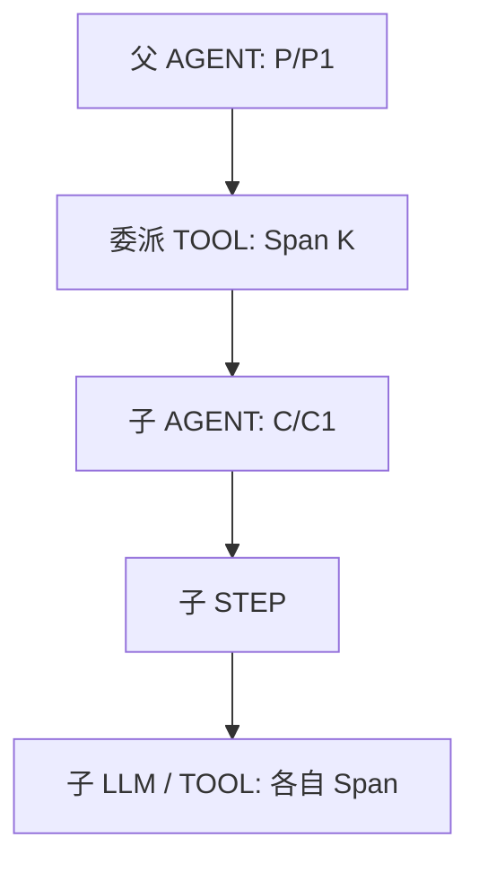

# 子 Agent 数据模型与采集设计

本文定义 LoongSuite Pilot 子 Agent 采集的目标契约，并解释 Codex 实现采用的关联方式。它适用于采集、归一化、日志输出与 Trace 转换，不涉及展示层实现。

**子 Agent 保留自己的 session、turn、step；调用拓扑通过真实 Trace 上下文连接；审计委派通过 invocation 关联。** 三者不可互相替代。

状态：Codex 的实现随本次变更提供，见[实现与验证入口](codex-subagent-verification.md)。Claude Code、Qoder CLI、Qoder IDE 的适配仍分别推进；OpenClaw、Hermes 保留已有正确 Trace 结构，后续补齐标准审计日志。本设计不代表所有 Agent 已实现或已通过真实安装态验收。

## 1. 为什么需要改造

历史 inline fusion 通过把子事件的 session/turn 改为父值来形成一棵 Trace。这样虽然能看到委派工具，却会丢掉子会话自己的历史身份，还会把复用、嵌套、后台执行和恢复绑在父 turn 的生命周期上。

仅记录父工具也不够：工具受理不等于子任务完成；一个工具可以派生多个工作；一个子 session 可以被多次委派；结果可能在父会话后续 turn 才被接收。仅靠 Trace、Agent 昵称或时间邻近，无法可靠还原这些工作关系。

成功条件：

1. JSONL、SLS、HTTP 与 OTLP 中，子执行始终保持自身会话与轮次身份。
2. 已确认上下文形成 `父 AGENT → 委派 TOOL → 子 AGENT → 子 STEP → LLM/TOOL`，不复制父身份。
3. 即使未启用 Trace 或被采样，也能仅从日志解析双向委派关系。
4. 复用同一子会话的新工作使用新 invocation；一次工作跨多个子 turn 时允许共享同一 invocation。
5. 父完成不结束后台子工作；缺少证据时保留独立执行，不猜测父级、不合成成功结果。

## 2. 三套关系

| 关系 | 字段 | 含义 |
| --- | --- | --- |
| 调用拓扑 | `trace_id`、`span_id`、`parent_span_id` | 哪个操作直接调用哪个操作 |
| 会话历史 | `gen_ai.session.id`、`gen_ai.turn.id`、`gen_ai.step.id` | 实际会话、输入触发的工作及模型步骤 |
| 审计委派 | `gen_ai.agent.invocation.id` ↔ `gen_ai.agent.parent.invocation.id` | 一次向外委派及接受这次委派的子工作 |

一个 Trace 可以包含多个 session；一个 session 可以跨多个 Trace。子 session 不是一个 invocation，一个 turn 也不必等于一个 invocation。

### 2.1 字段归属

| 字段 | 填写规则 |
| --- | --- |
| `gen_ai.session.id` | 当前实际会话；有独立子会话时保留子 ID。没有原生独立会话的运行时不伪造一个。 |
| `gen_ai.turn.id` | 当前会话的实际工作轮次；不能覆盖为父 turn。缺少原生 ID 时在真实输入边界生成稳定、可恢复的 opaque ID。 |
| `gen_ai.step.id` | 当前 turn 的模型步骤；请求、响应与对应工具保持一致的步骤关联。 |
| `trace_id` | 当前操作的 Trace；确认同一调用链后可跨 session 共享。 |
| `span_id` | 当前操作的实际 Span；工具 call/result 共用工具 Span，子模型不得全部填父工具 Span。 |
| `parent_span_id` | 最终 Span 的直接父级；输入侧子树挂载提示与最终父级须区分。 |
| `gen_ai.agent.invocation.id` | 当前事件所描述的向外委派；父 invoke/result 使用相同 ID。 |
| `gen_ai.agent.parent.invocation.id` | **当前事件所属工作接受的上游委派**，不是整个子 session 的永久属性。 |
| `gen_ai.agent.id` | 当前执行 Agent 实例；跨产品不能假设等于 session ID。 |
| `gen_ai.agent.parent.id` | 有可靠依据的创建/委派 Agent 身份，不替代 invocation。 |
| `gen_ai.agent.peer.id` | invoke/result 的直接交互 Agent；与 parent 的含义不同。 |
| `gen_ai.tool.call.id` | 原生工具配对键；一个工具可对应多个 invocation。 |
| `event.id` | 单条审计事件的稳定 ID；重试/重放不变，不同语义事件不能共用。 |

顶层自主输入不带 incoming invocation。用户后来直接在旧子 session 中发起独立工作，也不继承首次 spawn 的 invocation。`gen_ai.agent.scope` 等内部适配标记不是本设计的关联键。

### 2.2 invocation 的生成与持久化

1. 原生 ID 能跨两侧确认、稳定且在审计作用域中唯一时，优先复用。
2. 否则在委派边界生成稳定 ID，并持久保存。可以使用完整委派身份的确定性摘要、持久随机 ID；一对一时也可复用已预留的工具 Span ID。
3. 局部 ID 需要加入父 session/turn 等必要命名空间，不能用昵称、task path 或时间戳代替身份。
4. invocation 的生成不依赖 OTLP 是否启用，也不等待 Trace 网络导出。
5. 同一工作重试沿用原 ID；向同一 session 提交新工作产生新 ID。

**批量派生 N 个子工作，必须生成 N 条 invoke 和 N 个不同 invocation。** 共享的 `gen_ai.tool.call.id` 保留同批关系，不能只生成一个批次 invocation，也不能让多个工作共享同一工具 Span ID 作为 invocation。

Codex 当前使用父 session、父 turn、原生 tool call ID、工作序号的 SHA-256 摘要前 32 个十六进制字符。它与工具 Span ID 分别计算，重放可复现，不要求其他 Agent 照搬这个格式。

## 3. 工作作用域：复用、并行与嵌套

父 P 第一次向子 C 派发 I1，C 的该工作中**所有**模型请求/响应、工具调用/返回及边界事件均携带 incoming I1，不是仅第一条 request 携带。

| 实际事件 | session / turn | incoming `parent.invocation.id` | outgoing `invocation.id` |
| --- | --- | --- | --- |
| P 派发 C | P / P1 | 无 | I1 |
| C 执行模型、工具 | C / C1 | I1 | 无 |
| P 复用 C，提交新工作 | P / P2 | 无 | I2 |
| C 执行新工作 | C / C2 | I2 | 无 |
| C2 再派发 D | C / C2 | I2 | I3 |
| D 执行工作 | D / D1 | I3 | 无 |

C 发出 I3 不会覆盖 C 当前工作的 incoming I2。已上报的 C1 历史不会改成 I2。一次委派的延续工作若跨多个子 turn，可以继续携带原 incoming；收到新逻辑工作才换新 invocation。

最小作用域是实际工作事件。若同一原生 turn 混入多个 incoming 工作，需要原生消息/运行上下文分别消歧；不能用全局“最近 invocation”覆盖整轮。Codex 当前以 session+turn 保存已确认绑定，无法消歧时不强填整轮，也不宣称任意消息粒度切换都已覆盖。

并行工作各用独立上下文；嵌套连接立即父工具，不连接最外层 spawn。采集器重启不创建新逻辑工作。

## 4. Trace 的结构与生命周期



同 Trace 模式只透传调用上下文，不改写身份。子 AGENT 指向实际父工具 Span，子 STEP/LLM/TOOL 保持子树内部直接层级；子虚拟 ENTRY 对转换器透明。

父工具返回受理后，其 Span 正常结束；子工作可以继续。父 turn 先结束、独立导出，不强制中断子 turn，不拉长父工具。各子 turn 按自身原生终态结束；单次模型 `finish_reason=stop` 不代表整个 Agent turn 结束。

输入记录可能统一携带父工具的挂载上下文，这不表示最终每个 LLM 都直接挂到该工具。预留父工具 Span ID 必须与最终实际导出工具 Span ID 一致。

未取得可靠父上下文时保留独立根结构；已独立导出的 Trace 不通过重发相同 Span 假装原地更新。已知 incoming invocation 仍可保留。若跨 Trace 表达异步因果，可使用真实上下文与 Span Link；invocation 关系不受 Trace 采样影响。

每个 Agent 只汇总自己的模型 token，不把子用量再次累计为父自身用量。需要后代总量时应另行定义聚合口径。

## 5. 审计事件

### 5.1 六个标准名与历史兼容

| 标准事件名 | 兼容短名 |
| --- | --- |
| `gen_ai.model.request` | `llm.request` |
| `gen_ai.model.response` | `llm.response` |
| `gen_ai.tool.call` | `tool.call` |
| `gen_ai.tool.result` | `tool.result` |
| `gen_ai.agent.invoke` | 无正式短名 |
| `gen_ai.agent.result` | 无正式短名 |

六个标准名都应被正确识别，不退化为 `other`。已有短名保持兼容；不默认长短名双写。工具事实和委派审计可以同时记录，但不能额外增加 Span、STEP 或 token。Agent invoke/result 不再次转换成模型或工具执行。

### 5.2 invoke、受理与实际结果

- `invoke`：确认向 Agent 提交了逻辑工作，未知 peer ID 可省略，不等子模型响应。
- 工具返回 `{agent_id, nickname}`、task path、“已受理”：证明创建或接收，不证明子工作完成。
- `result`：运行时实际交付结果或明确派发失败时记录。未观察到结果不能合成成功。
- wait/status 查询、取消及纯通知不一概算新 invoke；`followup_task`/`send_input` 实际提交新工作时才算。
- 流式或分段结果按真实运行时边界保留，不能从缺少结果推断“必定只有一个终态”。Codex 当前对同一 invocation 的已确认结果去重；其他运行时若支持多段交付，应另行落实原生边界。

Codex 的 `FINAL_ANSWER` 是 transcript 内部 `agent_message` 的结果交付标记，是生成标准 result 的来源之一，不是标准事件本身，也不等同于子 turn 的 `task_complete`。只有交付能够唯一关联到 invocation、且尚未记录时才生成对应 result。受支持 wait/activity 中明确的实际结果或派发失败也可成为来源；单纯状态摘要或受理返回不行。

### 5.3 关系字段示例

以下为合成示例，仅列出关联字段，省略时间、用户等公共属性。I1 是独立 invocation；K 是工具 Span，M 是子模型 Span。

```json
[
  {"event.id":"e-invoke", "event.name":"gen_ai.agent.invoke", "gen_ai.session.id":"P", "gen_ai.turn.id":"P1", "gen_ai.agent.invocation.id":"I1", "gen_ai.tool.call.id":"call-1", "span_id":"K"},
  {"event.id":"e-child-model", "event.name":"gen_ai.model.request", "gen_ai.session.id":"C", "gen_ai.turn.id":"C1", "gen_ai.step.id":"S1", "gen_ai.agent.parent.invocation.id":"I1", "span_id":"M"},
  {"event.id":"e-result", "event.name":"gen_ai.agent.result", "gen_ai.session.id":"P", "gen_ai.turn.id":"P2", "gen_ai.agent.invocation.id":"I1"}
]
```

异步 result 可以属于接收方后续 P2；原始发起位置仍是 invoke 的 P1。不能把 result 接收轮次当作委派来源，也不能为 result 伪造一个仍在运行的旧工具 Span。

### 5.4 仅日志的双向关联

```text
在同一租户/授权数据范围内：
  先按 event.id 去重
  parent = event.name == gen_ai.agent.invoke
  child  = 存在 gen_ai.agent.parent.invocation.id 的实际工作事件
  parent.gen_ai.agent.invocation.id == child.gen_ai.agent.parent.invocation.id
  输出 distinct(父 session, 父 turn, invocation, 子 session, 子 turn)
```

反查同样限定父侧事件为 invoke，避免后续 result 覆盖发起位置。不能用相同 Trace、昵称、最近时间、Agent ID 或内部 scope 标记代替等值关联。父 invoke 已到而子侧未到，只表示尚未观测到目标；查询窗口、权限和保留期限也可能让一侧不可用，不能推断没有子 Agent。

## 6. Codex 参考实现

Hook 继续只提供 transcript 位置、唤醒和可用环境上下文，本次不修改 Hook 协议。collector 从原生 rollout JSONL 增量解析所有执行事实。

1. 提取 owning `session_meta`、`turn_context`、模型波次、工具 call/output、token 与原生终态；识别 fork 复制历史，避免重复采集祖先执行。
2. 从 spawn、新工作提交、伴随 activity 和实际返回解析子 thread ID/task path；保存立即父 session/turn、tool call、实际 Trace/Span、invocation 和证据来源。
3. 结合原生 turn 标识、明确 child 身份和 incoming 工作指纹绑定。密文载荷仅作 opaque 指纹匹配，不解密，不持久化额外工作正文。歧义时独立采集。
4. 日志按已闭合步骤增量发送；invoke 不等子执行；实际结果关联暂不明确时保留原始记录范围，重试关联，不重放模型和工具事实。
5. OTLP 按子自身 turn 缓冲，只有原生 `task_complete/turn_aborted` 关闭；父终态不关闭子工作。
6. 委派、结果去重、工作绑定与输入游标可恢复。启用 OTLP 时先持久化 pending-turn journal，再允许输入游标推进；已确认导出的轮次保留有界确认记录。
7. SLS/HTTP Codex 输出等待实际成功回执。HTTP 暂时断网保留原批次等待并自动重试；最终持久接收失败冻结共享 checkpoint，同时暂停新采集和后续批次入队，修复后重启恢复。停止时取消 SLS/HTTP 在途请求与重试等待，未确认游标不推进。多输出部分成功或回执不确定仍可重复相同稳定 ID，交付语义是 at least once，不是恰好一次。
8. 恢复重放再次应用当前 workspace/content/masking 策略；journal 按组增量读取，避免一次加载全部待完成工作。

源码路径、发送条件及验证命令见[Codex 实现与验证入口](codex-subagent-verification.md)。历史 fusion 文档仅用于理解迁移与旧 checkpoint，不再是新模型的行为契约。

## 7. 其他 Agent 的实施顺序

1. 先确认原生会话/轮次、工具与子运行的可靠标识，明确版本和采集边界。
2. 若存在身份覆盖，先同步调整 builder、边界、converter、buffer 和 checkpoint，恢复子身份及独立生命周期；不能只删两行赋值。
3. 为每次逻辑工作建立独立 invocation，覆盖复用、批量、嵌套和后台执行。
4. 补齐父 invoke/result 与全部相关子工作事件的 incoming；区分受理和实际结果。
5. 逐输出检查字段、身份、内容策略与重放稳定性，验证长短名无重复计数。
6. 按下面矩阵验收，分别报告源码/单元、跨输出集成、真实安装态与云端回读。

OpenClaw/Hermes 已有 Trace 保留子身份、真实父工具挂载及独立生命周期，当前任务仅新增标准 Log 和 invocation，不重构其 Trace。[现有 Trace 说明](subagent-tracing.md)。Qoder CLI/IDE 与相关进行中的采集改造需要协调，但一层 inline Trace 不自动等价于本设计完成。

## 8. 验收矩阵

| 场景 | Trace 断言 | Log / 关系断言 |
| --- | --- | --- |
| 普通多轮 | 各轮独立，不引入子树 | session 稳定，无伪造 incoming |
| 单次 spawn | 子 AGENT 指向实际工具 | invoke I = 子 incoming I；子身份保留 |
| agent_id/nickname 返回 | 精确 child 关联，不强制 activity/path | 工具日志正常保留，关系可解析 |
| task path/activity | 仅无歧义证据挂载 | path/nickname 不当作会话身份 |
| 批量/并行 | 各自挂载、Span 唯一 | N 工作=N invoke=N 独立 I，共同 call ID 保留批次 |
| 复用 session | 挂当前工具，不沿用首次 Trace | 新工作 I2，历史 I1 不变 |
| 一委派跨多个 turn | 各 turn 独立结束 | 可共用 I，不伪造额外委派 |
| 多层嵌套 | 挂立即父工具 | 中间同时保留 incoming I、outgoing J |
| 父先结束、后台晚到 | 父及时导出，子不强制中断、不拉长工具 | 子晚到仍按 I 关联 |
| 中断/恢复/派发失败 | 使用真实终态 | 受理不算完成，不合成成功 |
| 子早于关联信息 | 有界暂存或独立降级，不重发更新 | 晚到证据可补关系，不改身份 |
| 重启/重放 | Span ID、挂载与终态稳定 | event ID/I 稳定，无额外逻辑调用 |
| fork/复制历史 | 只构建当前线程执行 | owning session 正确，祖先事实不重复 |
| 内容关闭/策略变化 | 拓扑保留，正文删除 | 关联元数据保留；恢复应用当前策略 |
| 长短事件名 | 拓扑一致，无重复 Span/STEP/token | 六标准名不落 other，默认不双写 |
| 仅 Log/跨 Trace/缺侧 | 不伪造同 Trace | 有两侧时等值 Join，缺侧明确不可用 |

集合回读按稳定 event ID/invocation/Span ID 比较缺失、额外和重复，再检查身份、父级、结果语义及用量，不能只对比总行数。单元通过不代表安装更新，安装成功不代表云端送达；旧环境报告不能代替本次开源源码的验证。

## 9. 参考

- [输出事件 Schema](output-event-schema.md)、[Trace 输出](trace-output.md)。
- [Codex 实现与验证入口](codex-subagent-verification.md)、[历史 fusion 说明](../codex-subagent-fusion.md)。
- [OpenTelemetry Trace API](https://opentelemetry.io/docs/specs/otel/trace/api/)、[Span Links](https://opentelemetry.io/docs/concepts/signals/traces/#span-links)：Trace 父子关系与异步因果。本设计的 invocation 作用域是 Pilot 的具体契约，不应将其全部称为上游强制要求。
